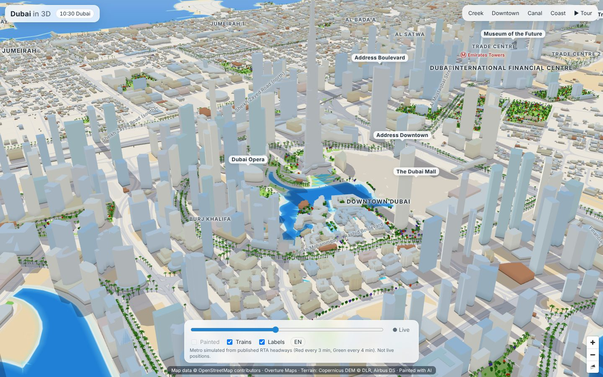
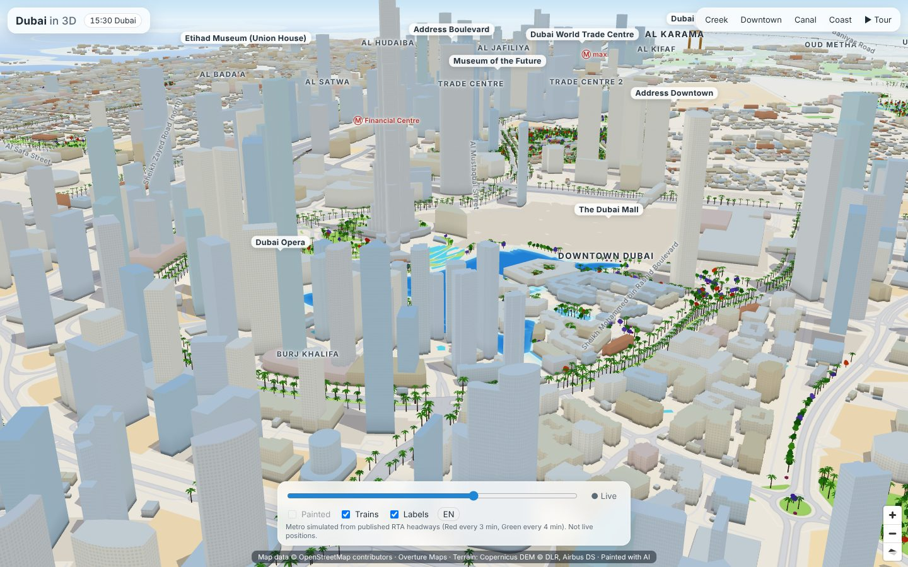
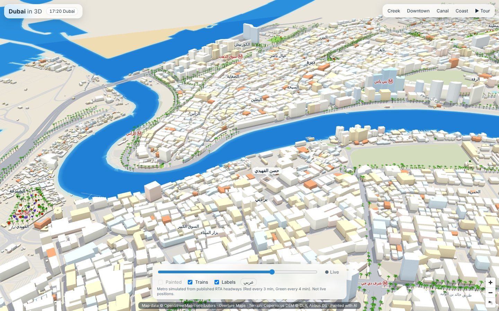
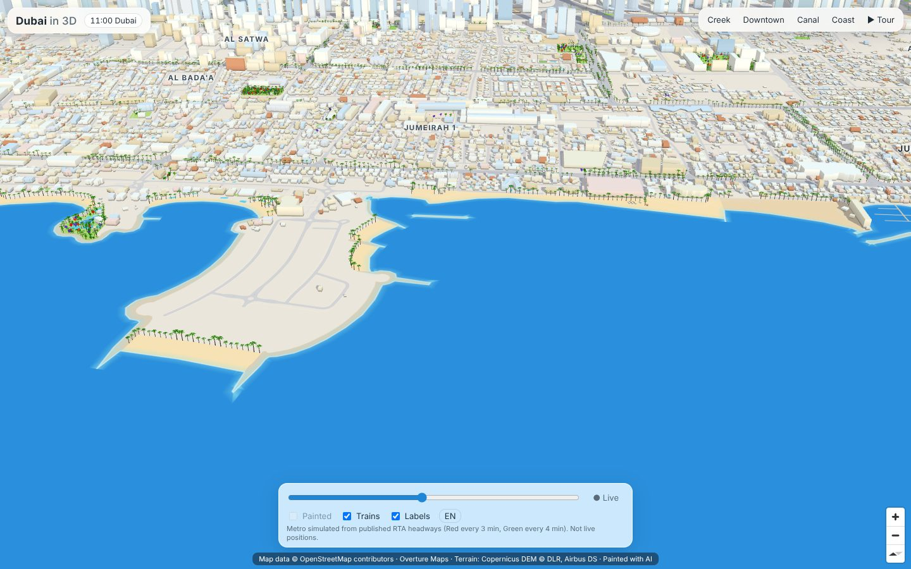
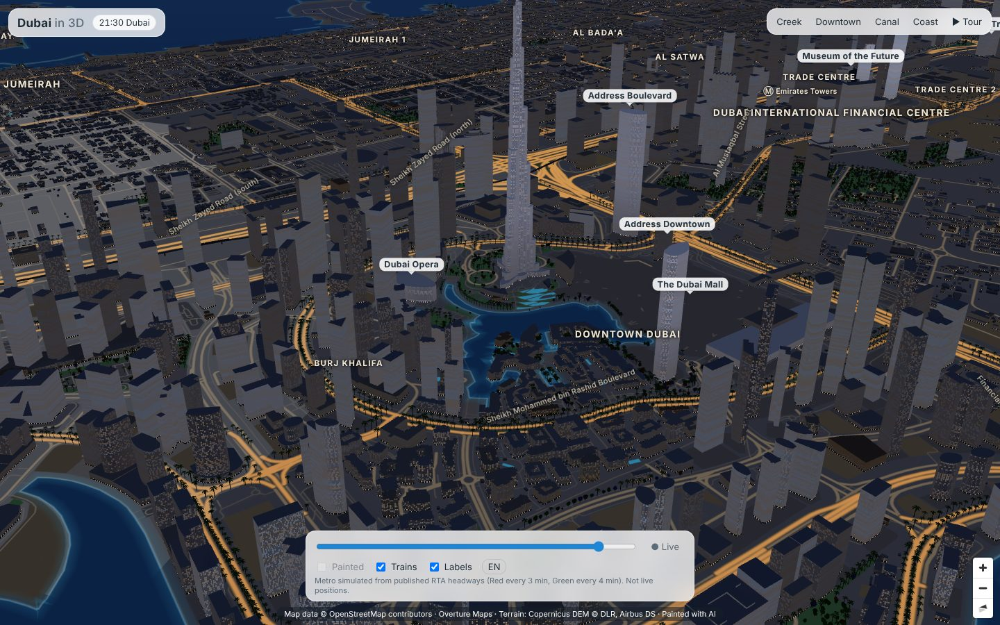

# Dubai in 3D

An interactive, stylised "miniature city" 3D map of Dubai that runs in the browser (desktop and iPhone Safari).
Pastel buildings with real heights, painted-looking ground, turquoise sea with a foam line, the Creek and Dubai Canal,
parks full of palms and flowering trees. It feels live: the sun follows the real time in Dubai, windows light up at night,
current weather sets the haze, and Dubai Metro trains run along their real tracks.



| | |
|---|---|
|  |  |
|  |  |

Pilot area: Al Shindagha / Bur Dubai / Deira waterfront → DIFC → Downtown (Burj Khalifa, Dubai Mall, Fountain lake) →
Business Bay and the Dubai Canal → Jumeirah coast. The bbox is one config value (see [Extending the area](#extending-the-area)).

## Quick start

```bash
cd dubai-3d
npm install
npm run dev          # http://localhost:5173 (tiles for the pilot are already in public/tiles)
npm run build        # static site in dist/
```

URL parameters, handy for sharing or testing: `?view=creek|downtown|canal|coast|fountain|metro` (skip the intro),
`?t=21:30` (freeze Dubai time), `?weather=dust|clear` (fake weather), `?notour`, `?noterrain`, `?static` (no animation).

## Scripts

| command | what it does |
|---|---|
| `npm run data` | full data pipeline: fetch → terrain → layers → vector tiles (cached; rerun is cheap) |
| `npm run data:rebuild` | rebuild layers + tiles from the cached raw data (after editing config or `landmarks.json`) |
| `npm run paint:estimate` | tile count and cost per image provider for the painted layer, no network |
| `npm run paint -- --pilot` | render and paint a 3×3 pilot, then build `painted.pmtiles` |
| `npm run paint -- --approve-pilot` / `--all` | unlock and run the full bbox (asks for confirmation) |
| `npm run dev` / `build` / `preview` | Vite |
| `npm run shoot [url] [dir]` | Playwright screenshots at several camera positions and times |

Pipeline requirements: Node 20+, Python 3.10+ (`pip install -r requirements.txt`), GDAL command line tools and
`tippecanoe` ≥ 2.17 (`apt install gdal-bin tippecanoe` or `brew install gdal tippecanoe`). For screenshots:
`npm i -D playwright && npx playwright install chromium`.

## How it works

```
config/area.json        bbox, camera presets, terrain exaggeration
config/landmarks.json   hand overrides: height, year, shape, Arabic name
config/paint.json       painted-layer prompt, seed, provider, prices
pipeline/
  fetch_overture.py     bbox-filtered GeoParquet reads straight from the Overture S3 bucket → data/raw/*.geojsonl
  fetch_dem.py          Copernicus GLO-30 COG (/vsicurl) → bare-earth filter → terrarium tiles → terrain.pmtiles
  build_layers.py       class mapping, heights, landmarks, vegetation, shoreline, metro, labels → layers + 3D chunks
  build_tiles.sh        tippecanoe → dubai.pmtiles (earth, water, shoreline, landuse, roads, piers, footprints)
  paint/                base renders → image model → cache → feathered mosaic → painted.pmtiles
src/
  main.ts  style.ts     MapLibre GL (v6) with PMTiles, terrain, sky; UI, tour, cards
  city3d.ts             Three.js custom layer: streamed building chunks, shadows, vegetation, landmarks
  buildWorker.ts        builds wall/roof/shadow meshes off the main thread (earcut)
  shaders.ts            facade windows (lit at night), AO, sun lighting, fog
  trains.ts             metro simulation   labels.ts  DOM labels (EN/AR)   env.ts  sun + weather
```

### Data

* **OpenStreetMap via Overture Maps.** Buildings, building parts, roads, rail, water, land use, land cover, coastline and
  neighbourhood names come from the monthly Overture release (`overtureRelease` in `config/area.json`). Overture's base,
  transportation and building themes are OSM-derived (ODbL) and add Microsoft/Google footprints and heights. The fetch
  reads only the Parquet row groups that intersect the bbox, so it downloads tens of MB, not a country extract, and puts
  no load on Overpass or the OSM tile servers.
  *Why not Geofabrik?* The build sandbox could not reach Geofabrik or Overpass. Overture gives one clean schema
  (heights, `num_floors`, Arabic and English names) for the same OSM data. To use a Geofabrik GCC extract instead, convert
  it with `osmium`/`ogr2ogr` into the same `data/raw/*.geojsonl` files and the rest of the pipeline runs unchanged.
* **Building heights**, in order: `height` (OSM `height` tag, or Overture's other sources) → `num_floors × 3.2 m + 1.5 m`
  (OSM `building:levels`) → median height of nearby buildings with a similar footprint (350 m radius; small villa
  footprints are capped at 12 m) → a default by building type or footprint size. In the pilot about 7% of buildings carry an
  explicit height. The rest are estimated, and the 'nearby' rule keeps Downtown tall and Jumeirah low.
* **Landmarks** (`config/landmarks.json`) are matched by name or GERS id and get exact heights and years.
  Multi-part buildings such as Burj Khalifa and Emirates Towers use Overture building parts for their setbacks. The Museum
  of the Future (torus) and the Dubai Frame are drawn procedurally, oriented along their footprints. Burj Al Arab is
  already listed and appears once the bbox reaches it.
* **Terrain**: Copernicus GLO-30 is a surface model, so towers show up as spikes. `fetch_dem.py` removes them with a
  morphological opening (150 m) and smooths the result. Vertical exaggeration is `terrainExaggeration` (default 1.5; Dubai
  has 0–20 m of relief). The sea is the map background and land comes from OSM's coastline polygons, so the coast is exact
  even in the context ring outside the bbox.
* **Trees and palms**: ~1.5k OSM trees and tree rows, plus ~60k procedural ones: scattered inside parks and gardens,
  palms along park edges, both verges of primary/secondary/trunk roads and the landward edge of Jumeirah beaches. They keep
  clear of buildings, water and carriageways. Mix: date palms, round shade trees, jacaranda purple, flame-tree orange,
  bougainvillea magenta.
* **Metro**: track geometry and tunnel/bridge ranges come from OSM. No public RTA GTFS feed was reachable (Dubai Pulse /
  data.dubai were blocked in the build environment), so trains are **simulated** from published headways and operating
  hours (Red ≈ 3 min peak / 5 off-peak, Green ≈ 4 / 6; Mon–Thu 05:00–00:00, Fri until 01:00, Sun from 08:00) with eased
  runs and 30 s dwell at each station. The UI says so. To use real GTFS, drop `stops.txt`/`stop_times.txt` in
  `data/raw/gtfs/` and replace `headway()`/`profile()` in `src/trains.ts`.

### Rendering

* MapLibre GL JS draws the ground from vector PMTiles (`dubai.pmtiles`, 7 MB for the pilot): land use, roads with
  casings, water with a blurred turquoise shallows band and a foam line drawn on real shoreline lines (not polygon outlines,
  which would show tile seams), on top of a terrain mesh. Sky and fog follow the sun and the weather.
* A Three.js custom layer shares MapLibre's WebGL context and draws:
  * **Buildings** streamed in 1.2 km chunks by distance. A worker builds the walls and earcut roofs. The facade shader
    draws window grids (denser on glass towers) that fade to their average colour at a distance, soft ambient occlusion at
    the base, sun and sky lighting, and distance fog. At night windows light up at random, shopfronts glow and landmarks
    are flood-lit.
  * **Shadows**: each building has a swept shadow volume projected along the sun vector in the vertex shader, drawn in its
    own pass with a stencil so overlapping shadows never double-darken.
  * **Vegetation** as instanced low-poly palms, trees and shrubs with wind sway. The level of detail drops instance counts
    with distance and hides trees below zoom 13.6.
  * **Metro** viaducts with pillars, and trains.
* Labels are DOM elements projected with the same matrix, so Arabic shapes correctly with system fonts and no glyph
  server is needed. They have a greedy collision pass.
* **Mobile**: pixel ratio capped at 1.75 (2 on desktop), no MSAA on touch devices, animation throttled to 30 fps,
  smaller tile cache, tree LOD, and chunks unload when far away.

### Live data

* **Sun**: SunCalc for the instant shown. "Live" follows the real clock in Asia/Dubai (UTC+4, no DST). The slider scrubs
  through today. Night, golden hour and dusk come from the sun's altitude.
* **Weather**: Open-Meteo `current` (temperature, cloud, visibility, weather code, humidity; free, no key), refreshed
  every 15 min. Low visibility with dry air reads as dust (sandy haze), cloud and rain add grey haze. The chip shows the
  temperature. If Open-Meteo is unreachable, the map falls back to clear weather and hides the chip.

## Painted with AI (optional ground layer)

1. `npm run paint:estimate` prints the cost before anything runs. Pilot bbox at z16: **460 tiles**, about 553 m each.
   At the configured prices that is ≈ $18 (Gemini 2.5 Flash Image), ≈ $23 (FLUX canny pro on Replicate) or ≈ $32
   (gpt-image-1 medium), and $0.36–0.63 for the 3×3 pilot. Prices are rough: check them in `config/paint.json`.
2. Put the provider's key in `.env` (see `.env.example`), then `npm run paint -- --pilot`. This renders each tile flat
   (no labels, no 3D), pixel-aligned at an integer zoom, with a 12.5% overlap per side. It sends the render with one fixed
   prompt and seed (`config/paint.json`), caches the result by `sha256(base image + provider + model + prompt + seed)`,
   blends overlaps with feathered weights and writes `public/tiles/painted.pmtiles` (WebP, z12–18). Reload the app and
   switch on **Painted**.
3. If you like the pilot: `npm run paint -- --approve-pilot`, then `npm run paint -- --all`. The full run refuses to start
   without the approval file and asks for confirmation. Reruns only pay for tiles whose base render or prompt changed.

Providers are pluggable (`pipeline/paint/providers.mjs`): `gemini`, `openai` (images/edits, which has no seed parameter,
so the cache provides determinism), `replicate` (FLUX + Canny control, which keeps geometry best), and `identity` (no AI,
no cost) for testing the render → mosaic chain. Select one with `--provider`.

### Which rendering approach to keep

Keep the **real-time stylised 3D** as the product and treat the painted raster as an optional skin:

* The live features (sun, night windows, weather haze, trains, landmark highlighting) all come from the real-time
  renderer. A painted raster is static: it can only be dimmed at night, which looks flat next to lit windows.
* Cost and size: the vector ground for the pilot is 7 MB and free to regenerate when OSM changes. The painted pyramid for
  the same bbox is roughly 150–250 MB of WebP plus $18–32 per repaint, and much more for Marina/Palm. That is heavy for
  phones on mobile data.
* Where the painted layer does help is the ground texture at mid zooms (lawns, sand, water). A good compromise is to
  paint only z15–16, cap the painted pyramid at z17, and keep the vector style for night.

## Extending the area

1. Edit `config/area.json` → `bbox` (west, south, east, north). For Palm Jumeirah, Dubai Marina and JBR:
   `[55.10, 25.06, 55.33, 25.28]`. Add camera presets if you like (`cameras`, used by the view buttons and `?view=`).
2. `npm run data` notices the changed bbox (each raw file records the bbox and Overture release it was fetched for), refetches
   Overture for the new area and the DEM tiles it needs, then rebuilds layers, chunks and tiles. Burj Al Arab, already in `landmarks.json`, appears automatically, and Dubai Tram is picked up
   from OSM and simulated at grade.
3. Repaint: `npm run paint:estimate`, then `--pilot`/`--all` as above. Already-painted tiles are reused from the cache.

Bumping `overtureRelease` also triggers a refetch. `python3 pipeline/fetch_overture.py --force [type…]` forces one.

## Deploy

The output is fully static: `dist/` (app) + `tiles/` (PMTiles read with HTTP Range requests, plus JSON chunks).

**Vercel**: import the repo, set *Root Directory* to `dubai-3d`. `vercel.json` sets the build, output and headers.
Tiles are served from the same deployment.

**Cloudflare Pages + R2** (recommended once the painted layer exists, because Pages caps single files at 25 MiB):
1. Pages: build command `npm run build`, output `dist`, root `dubai-3d`. `public/_headers` sets caching and CORS.
2. R2: create a public bucket (custom domain or r2.dev), then `bash scripts/upload-r2.sh <bucket> dubai`. Add a CORS rule:
   ```json
   [{ "AllowedOrigins": ["https://your-site.pages.dev"], "AllowedMethods": ["GET", "HEAD"],
      "AllowedHeaders": ["Range", "If-Match"], "ExposeHeaders": ["ETag", "Content-Range", "Content-Length"], "MaxAgeSeconds": 86400 }]
   ```
3. Build with `VITE_TILES_BASE=https://<r2-domain>/dubai/ npm run build`. The app then reads every `tiles/…` file
   (PMTiles, `meta.json`, `b3d/` chunks) from R2.

## Known limitations

* Heights: about 93% of buildings in the pilot have no height in the data and are estimated. Add important buildings to
  `landmarks.json`, or contribute heights to OSM.
* The metro is simulated. Underground sections (Bur Dubai/Deira) are hidden on purpose.
* The Museum of the Future and Dubai Frame shapes are stylised approximations oriented from their OSM footprints.
* No real cast shadows on facades (ground only). Pitched roofs are not modelled.
* The paint pipeline was tested end to end with the `identity` provider. No paid model was called while building this.

## Attribution

Map data © OpenStreetMap contributors (ODbL) · Overture Maps · Terrain: Copernicus DEM © DLR, Airbus DS (Copernicus
GLO-30) · Painted with AI. The exact line is fixed on screen in the app footer.
